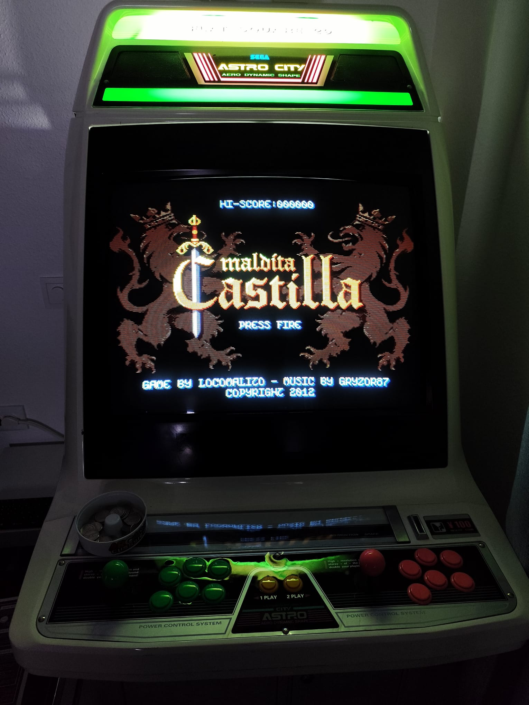

# Maldita Castilla for Recalbox 10 (Raspberry Pi 5)

<p align="center">
  
</p>

<p align="center"><em>Running on a Sega Astro City cab with Recalbox RGB JAMMA 2 + Pi 5</em></p>

**English** · [Español ↓](#maldita-castilla-para-recalbox-10-raspberry-pi-5)

Ready-to-install package so you can play **Maldita Castilla** on **Recalbox 10** for **Raspberry Pi 5**, including RGB JAMMA / CRT setups.

It uses the [AnyGM](https://github.com/retrodiv/AnyGM-libretro) libretro core and a custom EmulationStation system (**GameMaker (AnyGM)**). No PortMaster / 32-bit loader required.

---

## Features

- Game data (`.droid`) + EmulationStation `gamelist` / media (box, image, wheel, video — cabinet layout)
- Prebuilt **aarch64** AnyGM core + `AnyGM.ini`
- Custom system entry (`systemlist.xml`)
- Theme logo + colors for `recalbox-next` / `recalbox-240p`
- Global EmulationStation logo (`system/resources/logos/anygm.svg`)
- Simple install guide: copy folders + one short SSH step (prefer **Update** / full `reboot`; avoid `killall emulationstation`)

## Requirements

- Recalbox **10.x** image for Pi 5 (`rpi5_64`)
- Network access to the Recalbox share (Samba) and SSH
- Tested on Recalbox **10.1.1** with RGB JAMMA 2

## Quick install

1. Copy the contents of [`package/share/`](package/share/) into `\\RECALBOX\share` (or `\\YOUR-IP\share`).
2. Copy theme files from [`package/tema_recalbox-next/`](package/tema_recalbox-next/) into the Recalbox theme paths (see [docs/INSTALL.md](docs/INSTALL.md)).
3. Over SSH, install the core into `/usr/lib/libretro/` (commands in the install guide).
4. Open **GameMaker (AnyGM)** → **Maldita Castilla**.

Full steps (EN/ES): **[docs/INSTALL.md](docs/INSTALL.md)** · Spanish walkthrough: **[LEEME.md](LEEME.md)**

## Repository layout

```
package/
  share/                 → copy into Recalbox share
  tema_recalbox-next/    → logo + theme partial
docs/
  INSTALL.md             → full install guide (EN + ES)
  media/                 → screenshots / cabinet photo
LEEME.md                 → Spanish step-by-step guide
LICENSE                  → MIT (packaging & docs only)
LICENSE.malditacastilla.txt
SOURCE.txt
CONTRIBUTORS.md
```

## Licensing and credits

This repository — packaging, EmulationStation config, theme snippets, and documentation — is **MIT** ([`LICENSE`](LICENSE)).  
**The game itself is not covered by that licence.**

*Maldita Castilla* © 2012 **Locomalito** — music by **Gryzor87** — is licensed under [Creative Commons Attribution-NonCommercial-NoDerivatives 4.0 International (CC BY-NC-ND 4.0)](https://creativecommons.org/licenses/by-nc-nd/4.0/). See [`LICENSE.malditacastilla.txt`](LICENSE.malditacastilla.txt).

Under that licence this package ships the game **unmodified**, with attribution and the licence text alongside it. Releases are free; the NonCommercial term applies to anyone mirroring or repackaging them.

The `.droid` package may also contain YoYo Games’ GameMaker Android runner components, which the CC licence does not cover; AnyGM needs the runner, and it is redistributed on the same footing as other public community ports.

**AnyGM** libretro core: [retrodiv/AnyGM-libretro](https://github.com/retrodiv/AnyGM-libretro) (see that project for its licence).

If you enjoy the game, support Locomalito at **https://locomalito.com**

## Contributors

See [`CONTRIBUTORS.md`](CONTRIBUTORS.md). Maintainer: **kapi21**.

## Related projects

- [gmcnaught/maldita.castilla-mister](https://github.com/gmcnaught/maldita.castilla-mister) — Maldita Castilla on **MiSTer FPGA** (different platform)
- [PortsMaster PortMaster Maldita Castilla](https://github.com/PortsMaster/PortMaster-New/tree/main/ports/maldita.castilla) — handheld / PortMaster packaging

---
---

# Maldita Castilla para Recalbox 10 (Raspberry Pi 5)

<p align="center">
  
</p>

<p align="center"><em>En cabina Sega Astro City con Recalbox RGB JAMMA 2 + Pi 5</em></p>

Paquete listo para jugar a **Maldita Castilla** en **Recalbox 10** para **Raspberry Pi 5**, también en cabinas RGB JAMMA / CRT.

Usa el core libretro [AnyGM](https://github.com/retrodiv/AnyGM-libretro) y un sistema custom de EmulationStation (**GameMaker (AnyGM)**). No hace falta PortMaster ni loader de 32 bits.

## Características

- Datos del juego (`.droid`) + `gamelist` / medias
- Core AnyGM **aarch64** + `AnyGM.ini`
- Entrada de sistema (`systemlist.xml`)
- Logo y colores para `recalbox-next` / `recalbox-240p`
- Logo global ES (`system/resources/logos/anygm.svg`)
- Guía sencilla: copiar carpetas + SSH (preferir **Update** / `reboot`; evitar `killall emulationstation`)

## Requisitos

- Imagen Recalbox **10.x** para Pi 5 (`rpi5_64`)
- Acceso Samba + SSH
- Probado en Recalbox **10.1.1** con RGB JAMMA 2

## Instalación rápida

1. Copia el contenido de [`package/share/`](package/share/) en `\\RECALBOX\share` (o `\\TU-IP\share`).
2. Copia el tema desde [`package/tema_recalbox-next/`](package/tema_recalbox-next/) (detalle en [docs/INSTALL.md](docs/INSTALL.md)).
3. Por SSH, instala el core en `/usr/lib/libretro/`.
4. Abre **GameMaker (AnyGM)** → **Maldita Castilla**.

Guía completa (EN/ES): **[docs/INSTALL.md](docs/INSTALL.md)** · Paso a paso ES: **[LEEME.md](LEEME.md)**

## Licencia y créditos

El empaquetado y la documentación de este repo están bajo **MIT** ([`LICENSE`](LICENSE)).  
**El juego no está cubierto por esa licencia.**

*Maldita Castilla* © 2012 **Locomalito** — música de **Gryzor87** — licencia [CC BY-NC-ND 4.0](https://creativecommons.org/licenses/by-nc-nd/4.0/). Ver [`LICENSE.malditacastilla.txt`](LICENSE.malditacastilla.txt).

El paquete distribuye el juego **sin modificar**, con atribución y el texto de licencia. Es gratuito; el término NonCommercial aplica a quien lo redistribuya.

El `.droid` puede incluir el runtime Android de GameMaker (YoYo Games), no cubierto por la CC; se redistribuye como en otros ports públicos que lo necesitan.

**AnyGM:** [retrodiv/AnyGM-libretro](https://github.com/retrodiv/AnyGM-libretro).

Si te gusta el juego, apoya a Locomalito en **https://locomalito.com**

## Contribuidores

Ver [`CONTRIBUTORS.md`](CONTRIBUTORS.md). Mantenedor: **kapi21**.

